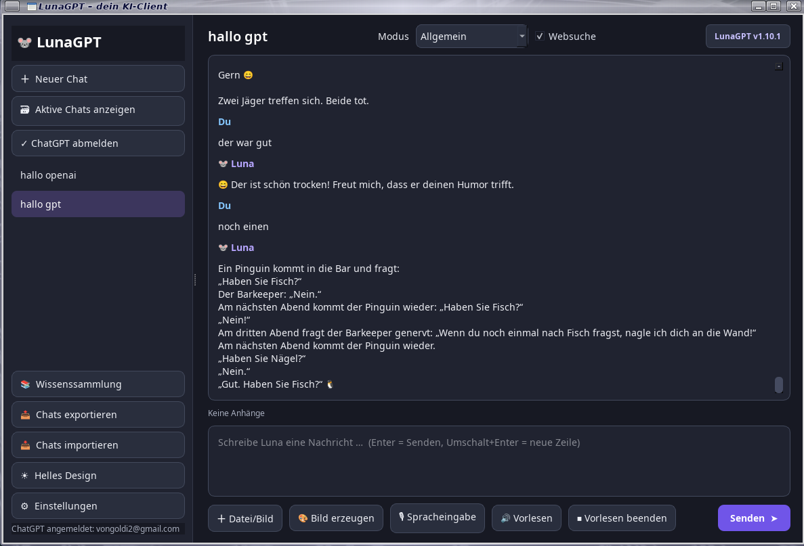

# LunaGPT 1.10.1

Deutschsprachiger Desktop-Chatclient für Linux und Raspberry Pi. LunaGPT bietet ChatGPT-Anmeldung, lokale Chat-Historie, Datei-Anhänge, Sprachein- und -ausgabe, Themes sowie KI-gestützte Dateiwerkzeuge.



[Github Seite](https://github.com/Angonikro/LunaGPT/)

## Funktionen

- Anmeldung über „Mit ChatGPT anmelden“ im Browser
- Lokale Chat-Historie und Datei-Anhänge
- Sprachein- und -ausgabe
- KI-gestützte Dateiwerkzeuge im lokalen Arbeitsbereich `~/Documents/LunaGPT-Arbeitsbereich/`
- Online-Bildgenerierung über AI Horde
- Deutsche Oberfläche und Kontextmenüs

### Bildgenerierung

Die Bildgenerierung nutzt AI Horde. Verfügbare Auswahlgrößen: 256 × 256, 512 × 512 und 621 × 621 Pixel. Die Auswahl 621 × 621 wird für die Anfrage auf 576 × 576 angepasst, da der Dienst passende Bildmaße verlangt. Bilder werden nicht automatisch dauerhaft gespeichert; zum Behalten bitte „Bild speichern unter …“ verwenden. Verfügbarkeit und Wartezeit hängen von den freiwillig bereitgestellten Rechnern des Dienstes ab. Es gibt keinen kostenpflichtigen Fallback.

## Installation unter Debian / Raspberry Pi OS

Lade `lunagpt_1.10.1_all.deb` herunter und installiere es:

```bash
sudo apt install ./lunagpt_1.10.1_all.deb
```

Start über das Anwendungsmenü oder im Terminal:

```bash
lunagpt
```

Das Paket installiert den Starter nach `/usr/bin/lunagpt` und die Anwendung nach `/usr/share/lunagpt/`. Es enthält keine virtuelle Python-Umgebung.

## Installation aus dem Quellcode

Voraussetzung: Debian-basiertes Linux mit Python 3 und den benötigten Systempaketen.

```bash
sudo apt update
sudo apt install python3 python3-pyside6.qtwidgets python3-pyside6.qtgui python3-pyside6.qtcore python3-cryptography python3-pyaudio poppler-utils alsa-utils espeak-ng
python3 -m pip install --user -r requirements.txt
python3 lunagpt/main.py
```

Falls die Distribution die Python-Pakete bereits systemweit bereitstellt, können diese statt `pip` verwendet werden. Unter Debian mit extern verwalteter Python-Umgebung keine systemweite pip-Installation erzwingen.

## Debian-Paket selbst bauen

Im Projektverzeichnis:

```bash
./build_deb.sh
```

Das Skript baut das Paket aus den enthaltenen Quellen und legt es in `dist/lunagpt_1.10.1_all.deb` ab. Benötigt wird `dpkg-deb`.

## Prüfen

```bash
python3 -m py_compile lunagpt/main.py lunagpt/siwc.py
dpkg-deb -I dist/lunagpt_1.10.1_all.deb
dpkg-deb -c dist/lunagpt_1.10.1_all.deb
```

## Projektstruktur

- `lunagpt/` – Python-Quellcode
- `bin/lunagpt` – Programmstarter
- `share/` – Desktop-Eintrag und Anwendungssymbol
- `debian/control` – Paketmetadaten
- `build_deb.sh` – Build-Skript
- `requirements.txt` – Python-Abhängigkeiten
- `CHANGELOG.md` – Versionshistorie

## Datenschutz und Dateiarbeit

Chat-Verlauf und Einstellungen werden lokal von der Anwendung verwaltet. Dateiwerkzeuge arbeiten ausschließlich im genannten LunaGPT-Arbeitsbereich. GitHub wird nicht automatisch kontaktiert oder aktualisiert; ein Upload muss separat erfolgen.

## Version

**1.10.1** – Scroll-Fix für die Chat-Ansicht nach dem Laden einer Unterhaltung und nach Lunas Antwort.

Siehe [CHANGELOG.md](CHANGELOG.md) für Details.

73 de DO2QG Andreas
