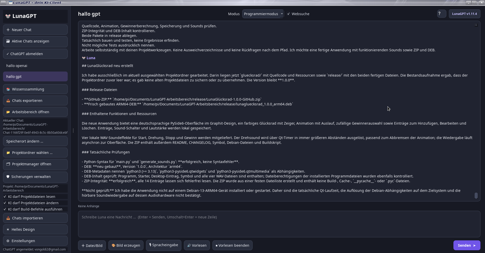

# LunaGPT 1.13.2

Zweisprachiger Desktop-Chatclient (Deutsch/Englisch) für Linux und Raspberry Pi. Die Sprache der Benutzeroberfläche lässt sich in den Einstellungen wählen und wird dauerhaft gespeichert. 
LunaGPT bietet ChatGPT-Anmeldung, lokale Chat-Historie, Datei-Anhänge, Sprachein- und -ausgabe, Themes sowie KI-gestützte Dateiwerkzeuge.



[Github Seite](https://github.com/Angonikro/LunaGPT/)

## Funktionen 
- Zweisprachiges Rechtsklick-Kontextmenü im Projektmanager-Editor (Deutsch/Englisch) mit Rückgängig, Wiederholen, Ausschneiden, Kopieren, Einfügen, Löschen und Alles auswählen.
- Ausführliche integrierte Hilfe mit Schritt-für-Schritt-Anleitung für Chats, Arbeitsbereich, Projektstart und Paketierung
- Projektpaketierung direkt im ausgewählten Projektordner: vorhandenes build_release.sh ohne sudo ausführen und ZIP/DEB anschließend prüfen
- Interne Projektsicherungen auflisten, lesen, vergleichen und nach Bestätigung wiederherstellen
- Lokaler Projekt-Arbeitsmodus mit Analyse, gezielter Mehrdatei-Bearbeitung, Sicherungen und Syntaxprüfung
- Anmeldung über „Mit ChatGPT anmelden“ im Browser
- Lokale Chat-Historie und Datei-Anhänge
- Auf ausdrückliche Bitte lokale Suche im vollständigen Verlauf des geöffneten Chats; normale Anfragen bleiben unverändert
- Sprachein- und -ausgabe; die Mikrofonaufnahme und Spracherkennung laufen in einem Hintergrundthread
- KI-Dateiwerkzeuge im lokalen Arbeitsbereich `~/Documents/LunaGPT-Arbeitsbereich/`
- Integrierter Projektmanager mit Dateibaum und Editor
- Optionaler KI-Lesezugriff und separat freischaltbarer Schreibzugriff auf ausgewählte Projektordner
- Automatische Sicherung vorhandener Dateien vor Änderungen
- Online-Bildgenerierung über AI Horde

## Menüleiste

Die obere Menüleiste bündelt die wichtigsten Funktionen:

- **Datei:** neuen Chat starten, Chats über **Datei → Chats importieren/exportieren** verwalten, Arbeitsbereich öffnen, Speicherort ändern und LunaGPT beenden.
- **Bearbeiten:** Rückgängig, Wiederholen, Ausschneiden, Kopieren, Einfügen und Alles auswählen für das aktuell fokussierte Eingabefeld bzw. den Editor.
- **Ansicht:** helles/dunkles Design wechseln sowie archivierte Chats, globale Suche und Gesprächsgedächtnis öffnen.
- **Projekte:** Projektordner auswählen, Projektmanager und Sicherungen verwalten.
- **Werkzeuge:** Globales Gedächtnis und Bildgenerierung öffnen.
- **Einstellungen:** eigener Menüpunkt für Programm-, Sprach-, Modell- und Audioeinstellungen.
- **Hilfe:** Anleitung und Informationen über LunaGPT.

Tastenkürzel: `Strg+N` neuer Chat, `Strg+F` globale Suche, `Strg+T` Design wechseln, `Strg+,` Einstellungen, `F1` Hilfe und `Strg+Q` Beenden.

## Globales Gedächtnis und Gesprächsgedächtnis

- **Globale Chat-Suche:** Durchsucht Nachrichten aller Chats einschließlich Archiv; Treffer zeigen Chat, Zeit und Textausschnitt. Ein Treffer öffnet den zugehörigen Chat und springt zur Fundstelle.
- **Zwei getrennte Gedächtnisebenen:** Das **globales Gedächtnis** speichert wichtige Projektentscheidungen, technische Lösungen und dauerhafte Arbeitsweisen chatübergreifend. 
- Zusätzlich besitzt jeder Chat ein eigenes **Gesprächsgedächtnis** für den aktuellen Gesprächskontext. Beide Ebenen speichern und rufen passende Informationen automatisch ab. 
- Beim Löschen eines Chats werden dessen Nachrichten und Chat-Erinnerungen gelöscht; globale Einträge bleiben erhalten. Globale Einträge zeigen ihren ursprünglichen Chat- oder Projektbezug als Herkunftshinweis. 
- Beide Gedächtnisse lassen sich getrennt verwalten. Zugangsdaten und sensible persönliche/medizinische Angaben werden ausgeschlossen.
- **Projektänderungen vergleichen:** Der Projektmanager kann den aktuellen Editorinhalt mit der gespeicherten Datei vergleichen und zeigt einen Unified-Diff, bevor Änderungen gespeichert werden.

## Integrierte Entwicklungssteuerung im Projektmanager

Der Projektmanager besitzt eine zusätzliche Build-/Start-/Debug-Leiste mit integrierter Programmausgabe. Python-Dateien können direkt gestartet und syntaktisch geprüft werden; C/C++-Einzeldateien werden mit Debug-Symbolen gebaut und gestartet. CMake-Projekte können konfiguriert und gebaut werden. Laufende Prozesse lassen sich stoppen; Programmeingaben können über das Eingabefeld an stdin gesendet werden. Die Leiste ist nur aktiv, wenn die separate Build-Ausführungsfreigabe für den ausgewählten Projektordner eingeschaltet ist. GDB kann interaktiv über Haltepunkte, Fortsetzen, Einzelschritt, Variablen-/Argumentanzeige, Aufrufstapel, Ausdrucksauswertung und überwachte Ausdrücke gesteuert werden. Die Konsole erkennt außerdem GCC-/Clang-Diagnosen und Python-Tracebacks; über „Zum Fehler springen“ wird die gemeldete Projektdatei geöffnet und die angegebene Zeile markiert.

## C++-Werkzeuge

Für C++-Entwicklung werden `build-essential` (unter anderem `g++` und `make`), `cmake`, `gdb` und `pkgconf` (stellt `pkg-config` bereit) benötigt. Bei Installation des DEB-Pakets werden diese Werkzeuge automatisch als Paketabhängigkeiten installiert. Bei Nutzung des GitHub-ZIP-Archivs installiert `install.sh` dieselben Werkzeuge. CMake-Builds und GDB-Debugging sind an die separat aktivierte Build-Ausführungsfreigabe des ausgewählten Projektordners gebunden. Die KI-Buildschnittstelle akzeptiert für CMake sowohl relative Pfade als auch absolute Pfade, sofern Quell- und Buildordner nach Auflösung innerhalb des ausgewählten Projektordners liegen. Dadurch funktionieren auch Projekte in tiefer verschachtelten Chat- und Unterordnern; Pfade außerhalb des freigegebenen Projektordners bleiben gesperrt.

Beispiele im ausgewählten Projektordner:

```bash
cmake -S . -B build
cmake --build build
gdb --batch --quiet -ex run -ex bt --args build/programm
```

Die GDB-Oberfläche arbeitet interaktiv über GDB-Kommandos. Erkannte lokale Variablen, Funktionsargumente und überwachte Ausdrücke werden zusätzlich in einer tabellarischen Variablenansicht angezeigt. Eine zweite Debugger-Registerkarte sammelt Speicherauszüge (`x/16xb`) und CPU-Registerausgaben. Die vollständige Ausgabe bleibt zusätzlich in der Konsole.

## Projektmanager-Editor

- Zeilennummern und Hervorhebung der aktuellen Zeile.
- Python- und C/C++-Syntaxhervorhebung sowie farbige JSON-Schlüssel, Werte und Zahlen.
- Suchen, Weitersuchen, Ersetzen und Alle ersetzen.
- Ungespeicherte Änderungen werden mit einem Punkt vor dem Dateipfad markiert.
- Änderungen an der geöffneten Datei durch andere Programme werden erkannt; bei ungespeicherten eigenen Änderungen fragt LunaGPT vor dem Neuladen.
- Bildvorschau für PNG, JPEG, BMP, GIF, WebP und TIFF. INI-, TOML-, YAML- und andere Text-Konfigurationsdateien können direkt im Editor angesehen und bearbeitet werden.

## Sprache der Benutzeroberfläche

LunaGPT unterstützt Deutsch und Englisch. Öffne **Einstellungen**, wähle unter **Sprache der Benutzeroberfläche** Deutsch oder English und speichere die Auswahl. Das Fenster wird anschließend in der gewählten Sprache neu aufgebaut. Chat, aktuelle Eingabe und angehängte Dateien bleiben beim Sprachwechsel erhalten. Die Spracheinstellung wird lokal gespeichert und beim nächsten Start wiederverwendet.

## Punktuelle Dateiänderungen (1.11.7)

Für kleine Änderungen an vorhandenen Projektdateien verwendet LunaGPT bevorzugt `patch_project_file`. Dabei wird ein exakt angegebener Textabschnitt ersetzt, statt eine große Datei vollständig neu zu schreiben. 
Der Patch wird nur angewendet, wenn der alte Abschnitt genau so oft vorkommt wie erwartet (standardmäßig genau einmal). Bei fehlenden oder mehrdeutigen Treffern bleibt die Originaldatei unverändert.

Vor dem Schreiben wird eine Sicherung unter `.lunagpt-backups/` erstellt und bytegenau verifiziert. Python-Dateien werden vor dem Speichern mit dem AST-Parser auf Syntaxfehler geprüft. 
Anschließend kontrolliert LunaGPT den gespeicherten Inhalt und erhält die Dateiberechtigungen. Die Funktion benötigt weiterhin die ausdrücklich aktivierte Projekt-Schreibfreigabe. Für neue Dateien oder ausdrücklich vollständige Ersetzungen bleibt `write_project_file` verfügbar.

## Datenschutz und Dateiarbeit

Chat-Verlauf und Einstellungen werden lokal verwaltet. Normale Dateiwerkzeuge arbeiten im eingestellten LunaGPT-Arbeitsbereich. Ein Projektordner wird im Projektmanager ausdrücklich ausgewählt. 
Lese- und Schreibzugriff müssen separat freigegeben werden. Vorhandene Projektdateien werden vor dem Überschreiben unter `.lunagpt-backups/` gesichert. Pfade außerhalb des ausgewählten Projektordners werden abgewiesen.

## Build-Befehle im ausgewählten Projektordner

LunaGPT kann auf ausdrücklichen Auftrag Build- und Prüfskripte direkt im aktuell ausgewählten Projektordner ausführen. Dafür müssen Lese-, Schreib- und die separate Build-Ausführungsfreigabe aktiviert sein. Für neu angelegte Projekte im chatbezogenen Arbeitsbereich kann Luna auf ausdrücklichen Build-/Startauftrag außerdem CMake konfigurieren, C++-Quelldateien mit g++/c++ kompilieren und ausführbare Dateien innerhalb dieses Arbeitsbereichs starten. Für Konsolenprogramme können für einen begrenzten Testlauf definierte stdin-Eingaben übergeben werden. Bei ausdrücklich verlangtem Build/Start soll Luna die Werkzeuge tatsächlich ausführen und nicht nur Terminalbefehle auflisten. 
Die Build-Freigabe ist standardmäßig ausgeschaltet und wird beim Wechsel des Projektordners zurückgesetzt. Unterstützt werden `build_deb.sh`, `build_release.sh` und `release.sh` im Projektstamm und in Unterordnern, Python `py_compile` sowie der Start vorhandener `.py`-Dateien, C++-Builds mit `g++`/`c++` in eine Ausgabedatei innerhalb des Projekts, der Start ausführbarer Projektdateien sowie Prüfungen mit `dpkg-deb`, `zip` und `unzip`. Für Python-Start z.B. `python3 ordner/main.py`; für C++ z.B. `g++ -fsyntax-only main.cpp` zur Syntaxprüfung, `g++ main.cpp -o build/app` zum Kompilieren und anschließend `./build/app` zum Starten. Befehle im ausgewählten Projektordner benötigen die separate Build-Ausführungsfreigabe und laufen ohne Shell-Verkettung und ohne `sudo`. Befehle im Chat-Arbeitsbereich sind nur bei ausdrücklichem Build-/Startauftrag verfügbar und bleiben auf diesen Arbeitsbereich begrenzt. Programme sind ausführbarer Code und können im Rahmen der Freigabe auf die Benutzerrechte des LunaGPT-Prozesses zugreifen; nur vertrauenswürdige Projekte starten. Befehle laufen ohne `sudo`, ohne Shell-Verkettung und mit Zeitlimit. Buildskripte sind ausführbarer Projektcode; aktiviere die Freigabe nur für vertrauenswürdige Projekte.

### Buildskripte in Projekt-Unterordnern

Die Projekt-Buildwerkzeuge unterstützen freigegebene Skripte `build_deb.sh`, `build_release.sh` und `release.sh` auch in Unterordnern des ausdrücklich ausgewählten Projektordners. Beispiel: `gluecksrad/build_release.sh`. Das Skript wird im eigenen Verzeichnis ausgeführt, 
sodass relative Pfade wie `release/` korrekt auf den Unterordner zeigen. Absolute Pfade, Pfadaufstiege (`..`) und Symlinks außerhalb des Projektordners werden weiterhin abgewiesen.


## Installation mit Debian-Paket (empfohlen)

Benötigt wird Debian 13 / Raspberry Pi OS mit ARM64 oder eine kompatible Debian-Umgebung.

```bash
sudo apt update
sudo apt install ./lunagpt_1.13.2_all.deb
# Benötigte MBROLA-Sprachausgabe:
sudo apt install mbrola mbrola-de4 mbrola-en1
```

Falls `apt` fehlende Abhängigkeiten meldet, installiert es diese normalerweise automatisch. Alternativ können die Laufzeitpakete vorab installiert werden:

```bash
sudo apt install build-essential cmake gdb pkgconf dpkg zip unzip python3 python3-pyside6.qtwidgets python3-pyside6.qtgui python3-pyside6.qtcore python3-cryptography python3-pyaudio poppler-utils alsa-utils espeak-ng mbrola mbrola-de4 mbrola-en1
```

Start über das Anwendungsmenü oder im Terminal:

```bash
lunagpt
```

Das DEB installiert den Starter nach `/usr/bin/lunagpt` und die Anwendung nach `/usr/share/lunagpt/`. Es wird keine virtuelle Python-Umgebung angelegt.

## Start aus dem ZIP-Archiv

1. ZIP-Datei entpacken.
2. In das entpackte Verzeichnis `LunaGPT` wechseln.
3. Systemabhängigkeiten installieren und das Startskript ausführen:

```bash
cd LunaGPT
sudo apt update
sudo apt install build-essential cmake gdb pkgconf dpkg zip unzip python3 python3-pyside6.qtwidgets python3-pyside6.qtgui python3-pyside6.qtcore python3-cryptography python3-pyaudio poppler-utils alsa-utils espeak-ng mbrola mbrola-de4 mbrola-en1
python3 lunagpt/main.py
```

Alternativ kann `./install.sh` verwendet werden. Das Skript installiert die Systempakete und startet LunaGPT. Es benötigt `sudo` für `apt`.

## MBROLA-Sprachausgabe (Standard)

LunaGPT verwendet für Deutsch die MBROLA-Stimme `de4` und für Englisch die britisch-englische MBROLA-Stimme `en1`. Dafür müssen `mbrola`, `mbrola-de4` und `mbrola-en1` installiert sein. eSpeak-NG bleibt als technische Schnittstelle erhalten, über die LunaGPT die jeweils passende MBROLA-Stimme ansteuert:

```bash
sudo apt install mbrola mbrola-de4 mbrola-en1
```

MBROLA stellt die Stimmen für beide Oberflächensprachen bereit: `de4` für Deutsch und `en1` für britisches Englisch. eSpeak-NG dient als technische Ansteuerung. Falls `apt` eines der MBROLA-Stimmenpakete nicht findet, prüfe, ob die Debian-Paketquellen `contrib` und `non-free` aktiviert sind. 
Die Stimmen werden lokal installiert und benötigen zur Wiedergabe keine Internetverbindung.

## Spracheingabe (optional)

Die Spracheingabe benötigt zusätzlich das Python-Modul `SpeechRecognition`. Mikrofonzugriff benötigt außerdem `python3-pyaudio` und `alsa-utils`, die oben über `apt` installiert werden.

```bash
python3 -m pip install --user --break-system-packages SpeechRecognition
```

Debian schützt die systemweite Python-Installation vor pip-Änderungen. Der Befehl verwendet deshalb ausdrücklich die Benutzerinstallation. Die eigentliche Aufnahme und Online-Spracherkennung blockiert die Programmoberfläche nicht. Für die Online-Erkennung ist eine Internetverbindung erforderlich.

## Abhängigkeiten

| Komponente | Zweck | Installation |
|---|---|---|
| Python 3 | Laufzeit für LunaGPT und Python-Projekte | `python3` |
| build-essential | C/C++-Compiler und Build-Werkzeuge (`g++`, `make`) für C++-Projekte | `build-essential` |
| cmake | CMake-Konfiguration und Projekt-Builds | `cmake` |
| gdb | Interaktives Debugging, Variablen, Speicher und Register | `gdb` |
| pkgconf | Erkennung und Einbindung installierter C++-Bibliotheken über pkg-config | `pkgconf` |
| PySide6 | Grafische Oberfläche | `python3-pyside6.qtwidgets`, `qtgui`, `qtcore` |
| cryptography | Verschlüsselungsfunktionen | `python3-cryptography` |
| PyAudio | Mikrofonzugriff | `python3-pyaudio` |
| SpeechRecognition | Optionale Spracheingabe | Benutzerinstallation über pip |
| poppler-utils | PDF-Textausgabe | `poppler-utils` |
| alsa-utils | Audio-Werkzeuge | `alsa-utils` |
| espeak-ng | Technische Schnittstelle zur Ansteuerung der MBROLA-Stimme | `espeak-ng` |
| MBROLA | Sprachausgabe-Engine | `mbrola` |
| MBROLA Deutsch (de4) | Deutsche MBROLA-Stimme | `mbrola-de4` |
| MBROLA Englisch (en1) | Britisch-englische MBROLA-Stimme | `mbrola-en1` |

`requirements.txt` enthält die Python-Kernabhängigkeiten für eine pip-basierte Entwicklungsumgebung. Für Debian wird die Installation der Systempakete über `apt` bevorzugt.

## Debian-Paket selbst bauen

Im Projektverzeichnis:

```bash
./build_deb.sh
```

Benötigt werden `dpkg-deb`, `zip` und `unzip` (auf Debian liefert das Paket `dpkg` das Werkzeug `dpkg-deb`). Die Paketversion wird automatisch aus `lunagpt/version.py` gelesen; die Versionsnummer muss im Build-Skript nicht separat gepflegt werden. Das fertige Paket liegt unter `dist/lunagpt_1.13.2_all.deb`.

## Prüfen

```bash
python3 -m py_compile lunagpt/main.py lunagpt/siwc.py lunagpt/version.py
dpkg-deb -I dist/lunagpt_1.13.2_all.deb
dpkg-deb -c dist/lunagpt_1.13.2_all.deb
```

## Projektstruktur

- `lunagpt/` – Python-Quellcode einschließlich zentraler `version.py`
- `bin/lunagpt` – Programmstarter
- `share/` – Desktop-Eintrag und Anwendungssymbol
- `debian/control` – Paketmetadaten
- `build_deb.sh` – Build-Skript
- `requirements.txt` – Python-Kernabhängigkeiten
- `CHANGELOG.md` – Versionshistorie

73 de DO2QG Andreas